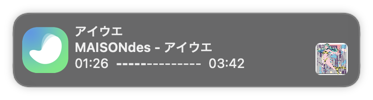
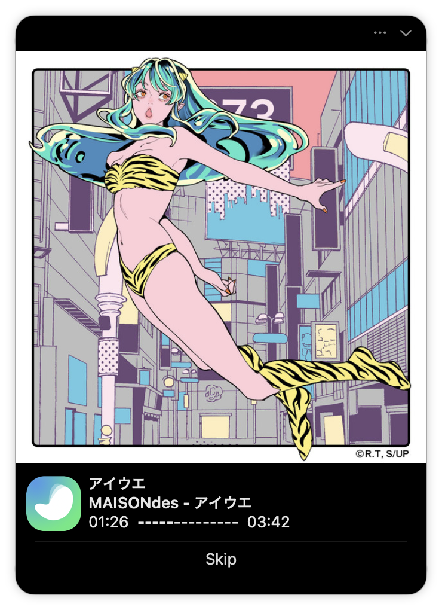
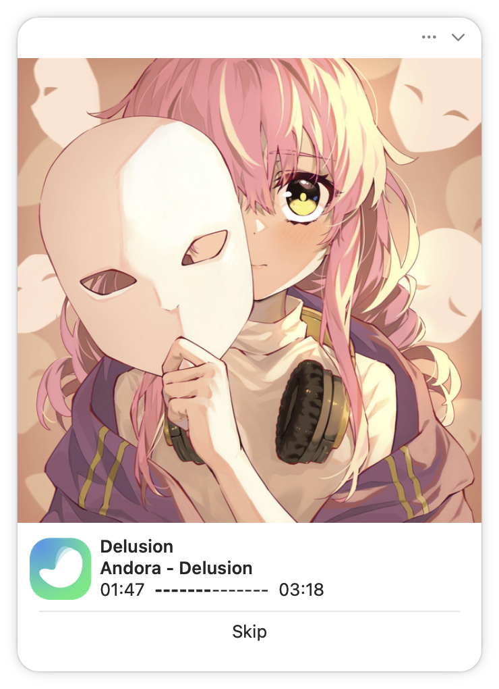
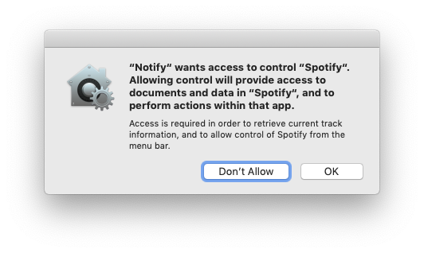

<p align="center">

</p>
<p align="center">


</p>
<p align="center">


</p>

# Notify

##### *Inspired by [Spotify Notifications](https://github.com/citruspi/Spotify-Notifications) written in Swift*

Menu bar app that shows what's playing in **Spotify or Apple Music** — as native notifications, in the menu bar, and (on macOS 26+) around the notch.

## [Download latest release here](https://github.com/nahive/spotify-notify/releases)

## Install via Homebrew

```
brew tap nahive/spotify-notify
brew trust nahive/spotify-notify
brew install --cask spotify-notify --no-quarantine
```

Homebrew 7 and later refuse casks from untrusted taps, so the `brew trust` step is needed there.

## Features

- [x] Spotify and Apple Music support, with automatic switching to whichever is playing ✨
- [x] Notification sounds (toggle)
- [x] Notification on play/pause (toggle)
- [x] Show song name in the menu bar (toggle)
- [x] Launch on login (toggle)
- [x] Album artwork (toggle)
- [x] Toggle disabling of notifications when player is focused (toggle)
- [x] Shortcuts for showing notification (customizable) ✨
- [x] Show progress of a song in notification ✨
- [x] Ability to skip song from notification, and favorite it in Apple Music ✨
- [x] Options to control player from menu bar, including shuffle, repeat and volume ✨
- [x] Searchable song history with play counts, charts and one-click replay
- [x] Now-playing pill around the notch with hover controls and scrubbing (macOS 26+) ✨
- [x] Shortcuts, Spotlight and Siri actions (App Intents) ✨
- [ ] Customizable options in notification
- [x] Localizations (English, Japanese)

## Notes

The first time you attempt to control Spotify or Apple Music, macOS presents the following dialog box:

<p align="center"></p>

You must grant permission for the app to work. Choosing Don't Allow will make the app unable to retrieve any information about the currently playing track.

If you click Don't Allow by accident, you can reset the permissions dialogue using

```
$ tccutil reset AppleEvents
```

The app builds and runs ad-hoc signed out of the box. To sign with your own account, create `Notify/Other/Local.xcconfig` (gitignored) containing:

```
DEVELOPMENT_TEAM = YOURTEAMID
CODE_SIGN_IDENTITY = Apple Development
```

## Building

**Requirements:** macOS 26 or later, Xcode 26 or later.

```
$ git clone https://github.com/nahive/spotify-notify.git
$ cd spotify-notify
$ open Notify.xcodeproj
```

## Contributing

If you found a **bug**, open an issue.

If you have a **feature** request, open an issue.

If you want to **contribute**, submit a pull request.

## License

The source code is dedicated to the public domain. See the `LICENCE.md` file for
more information.

The Spotify artwork and icon is owned by Spotify AB Inc.
