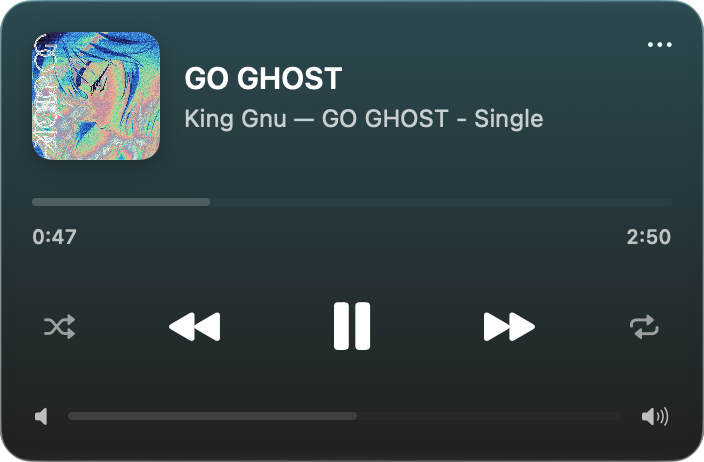
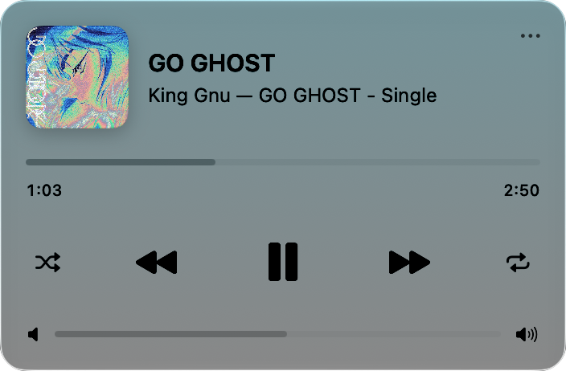
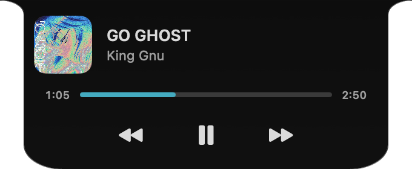
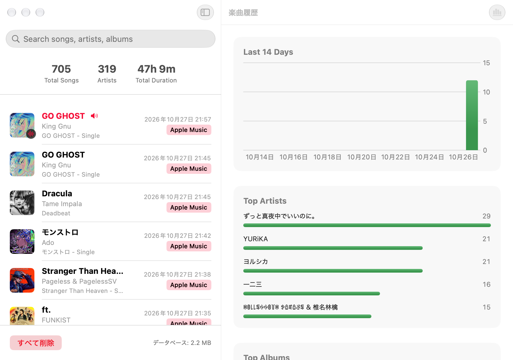

<p align="center">

</p>
<p align="center">


</p>
<p align="center">

</p>
<p align="center">
<picture>
  <source media="(prefers-color-scheme: dark)" srcset="docs/history-dark.png">
  
</picture>
</p>

# Notify

##### *Inspired by [Spotify Notifications](https://github.com/citruspi/Spotify-Notifications) written in Swift*

Menu bar app that shows what's playing in **Spotify or Apple Music**: native notifications, a mini-player in the menu bar, a now-playing card around the notch, and a searchable listening history.

**Requires macOS 26 (Tahoe) or later.**

## [Download latest release here](https://github.com/nahive/spotify-notify/releases)

## Install via Homebrew

```
brew tap nahive/spotify-notify
brew trust nahive/spotify-notify
brew install --cask spotify-notify
xattr -dr com.apple.quarantine /Applications/Notify.app
```

Homebrew 7 and later refuse casks from untrusted taps, so the `brew trust` step is needed there.

Notify is signed but not notarized, so macOS refuses to open it until the quarantine flag is removed; the `xattr` line does that. Run it again after each `brew upgrade --cask spotify-notify`, and after installing from a downloaded release. (Homebrew 7 removed the `--no-quarantine` option that used to handle this.)

## Features

**Players**
- Spotify and Apple Music, following whichever is playing, or pinned to one

**Menu bar**
- Mini-player with artwork, scrubbing, shuffle, repeat and volume
- Optional song name in the menu bar

**Notifications**
- A banner on every track change, and optionally on play and pause
- Album artwork, song progress and sound, each optional
- Skip from the banner, and favorite in Apple Music
- Optionally silent while the player is the frontmost app
- A global keyboard shortcut that shows the current song

**Notch**
- A now-playing card around the notch, or a floating pill on displays without one, with controls and scrubbing on hover

**History**
- Searchable listening history with play counts and one-click replay
- Charts of plays per day, top artists and top albums

**Automation**
- Shortcuts, Spotlight and Siri actions: play/pause, skip, current song, recent songs and more

**Other**
- Launch at login
- English and Japanese

## Notes

The first time you attempt to control Spotify or Apple Music, macOS presents the following dialog box:

<p align="center"></p>

You must grant permission for the app to work. Choosing Don't Allow will make the app unable to retrieve any information about the currently playing track.

If you click Don't Allow by accident, you can reset the permission dialog for Notify with

```
$ tccutil reset AppleEvents io.nahive.SpotifyNotify
```

The app builds and runs ad-hoc signed out of the box. To sign with your own account, create `Notify/Other/Local.xcconfig` (gitignored) containing:

```
DEVELOPMENT_TEAM = YOURTEAMID
CODE_SIGN_IDENTITY = Apple Development
```

## Building

**Requirements:** macOS 26 or later, Xcode 26 or later.

```
$ git clone https://github.com/nahive/spotify-notify.git
$ cd spotify-notify
$ open Notify.xcodeproj
```

## Contributing

If you found a **bug**, open an issue.

If you have a **feature** request, open an issue.

If you want to **contribute**, submit a pull request.

## License

The source code is dedicated to the public domain. See the `LICENCE.md` file for
more information.

The Spotify artwork and icon are owned by Spotify AB Inc.
